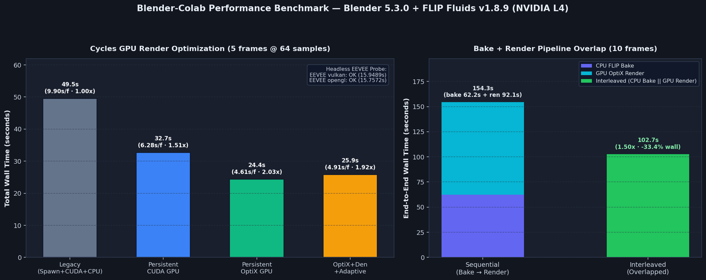
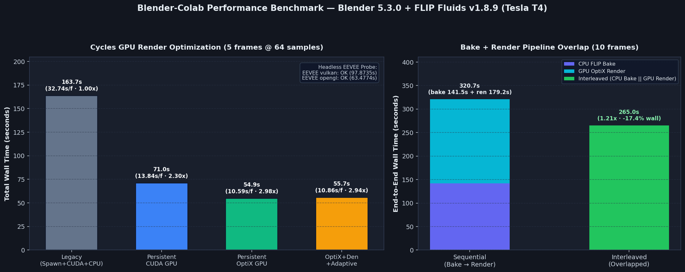
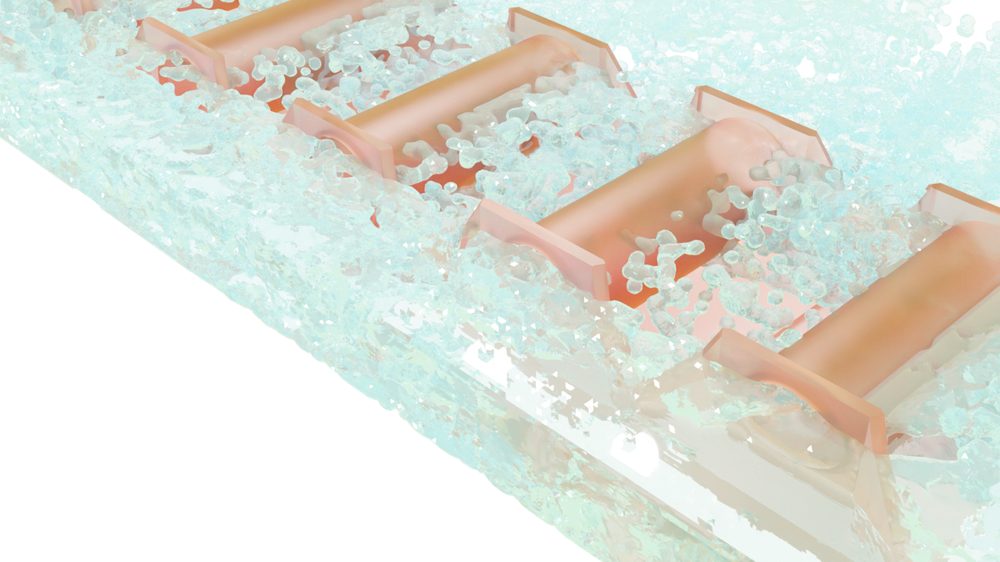
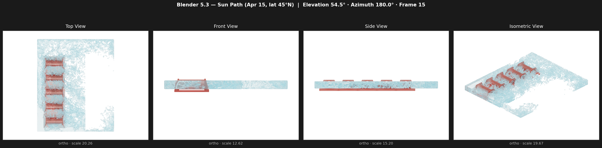
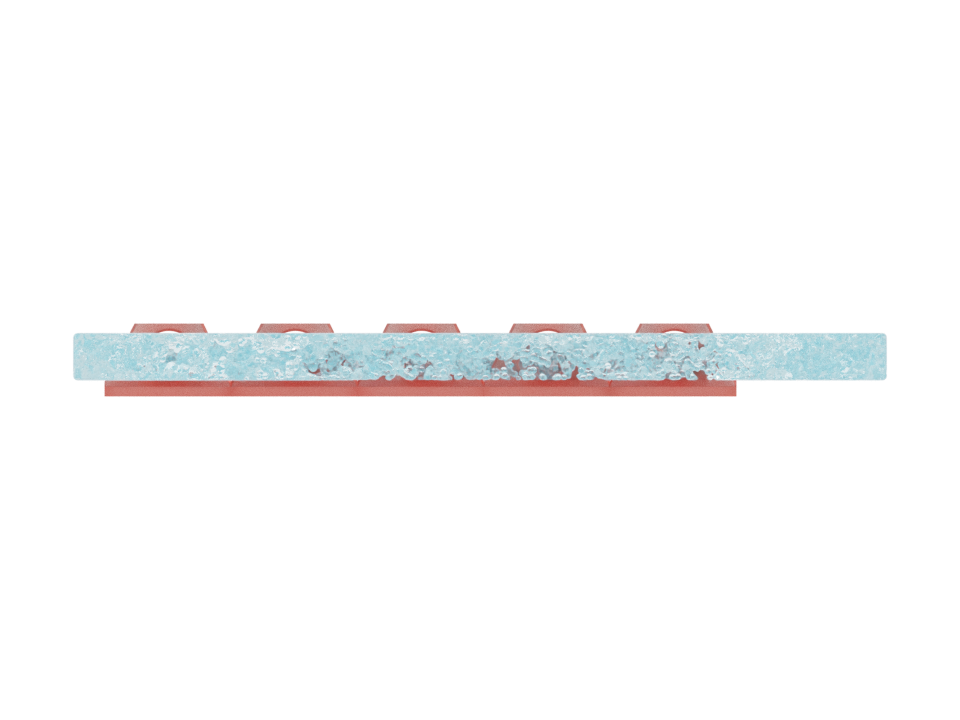
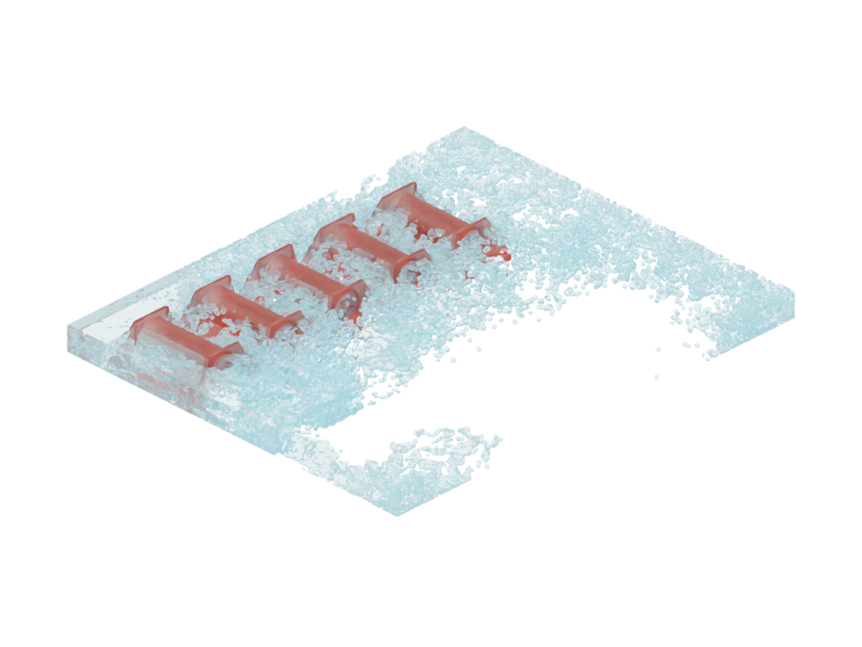

# Blender-Colab

[](https://colab.research.google.com/github/1kaiser/Blender-Colab/blob/master/BlenderColab.ipynb)

> **GPU-accelerated Blender 5.3.0 rendering and unwatermarked FLIP Fluids v1.8.9 simulation on Google Colab and headless Linux.**
> Features **Cycles OptiX + `use_persistent_data`**, **overlapping CPU-bake || GPU-render interleaving**, **automated legacy scene/shader sanitization**, **single-process 4-view April Sun Path orthographic rendering**, and **multi-session Colab swarm orchestration**.

**Jump to:** [Benchmarks](#benchmarks) &middot; [Fluid Preview & Sun Path](#visual-outputs) &middot; [Quick Start](#quick-start) &middot; [CLI Workflows](#cli-workflows) &middot; [Architecture Details](#architecture) &middot; [Notes & License](#notes)

---

<a id="benchmarks"></a>
## Verified Colab GPU Benchmarks

Measured on **Google Colab NVIDIA L4** (`23,034 MiB` VRAM, `12` Intel Xeon vCPUs @ `2.20 GHz`, `52.96 GiB` RAM, Driver `580.82.07`) and **Google Colab Tesla T4** (`15,360 MiB` VRAM, `2` Intel Xeon vCPUs @ `2.00 GHz`, `12.67 GiB` RAM) using **Blender 5.3.0** + unwatermarked **FLIP Fluids v1.8.9** (`Source 706YX`) on `particles.blend` (`resolution=192`, `64` Cycles samples; JSON in [`outputs/colab_benchmark.json`](outputs/colab_benchmark.json) and [`outputs/t4/colab_benchmark.json`](outputs/t4/colab_benchmark.json)):

<a href="assets/colab_benchmark_chart.png"></a>

### Cycles & Headless EEVEE Render Speed (5 Frames @ 64 Samples — L4 vs. T4)

| Configuration | L4 Wall (s) | L4 Speedup | T4 Wall (s) | T4 Speedup | L4 vs. T4 |
|---|---:|---:|---:|---:|---:|
| Legacy Baseline (Per-Frame Spawn + CUDA + CPU) | 49.52 (9.90s/f) | 1.000x | 163.71 (32.74s/f) | 1.000x | 3.31x faster |
| Persistent CUDA GPU-Only (`use_persistent_data=True`) | 32.73 (6.28s/f) | 1.513x | 71.03 (13.84s/f) | 2.305x | 2.17x faster |
| **Persistent OptiX GPU-Only (`use_persistent_data=True`)** | **24.35 (4.61s/f)** | **2.034x** | **54.88 (10.59s/f)** | **2.983x** | **2.25x faster** |
| Persistent OptiX + OpenImageDenoise + Adaptive (`0.02`) | 25.85 (4.91s/f) | 1.916x | 55.72 (10.86s/f) | 2.938x | 2.16x faster |
| Headless `BLENDER_EEVEE` (`--gpu-backend vulkan`, 1f @ 16s) | 17.00 (15.95s render) | — | 99.05 (97.87s render) | — | 5.83x faster |
| Headless `BLENDER_EEVEE` (`--gpu-backend opengl`, 1f @ 16s) | 16.81 (15.76s render) | — | 64.55 (63.48s render) | — | 3.84x faster |

### Sequential vs. Interleaved Bake + Render Pipeline (10 Frames @ `res=192`, `64` Samples)

| Pipeline Mode | L4 (Bake / Render / Wall) | L4 Saved | T4 (Bake / Render / Wall) | T4 Saved |
|---|---|---|---|---|
| Sequential (`bake` then `render_persistent`) | 62.23s / 92.08s / **154.32s** | — | 141.54s / 179.17s / **320.71s** | — |
| **Interleaved (CPU FLIP Bake \|\| GPU OptiX Render)** | 62.52s / 101.37s / **102.72s** | **1.502x (-33.43%)** | 208.75s / 262.13s / **264.95s** | **1.210x (-17.39%)** |

> On a full **25-frame** `particles.blend` run (`res=192`, `64` samples, L4), interleaved execution completed all 25 baked frames, 25 Cycles OptiX renders, `animation.mp4` (`2.56 MiB`), and `animation_preview.gif` (`807.4 KiB`) in **418.84 s** (`6.98 min`) total (`outputs/interleaved_run.json`).

<details>
<summary><b>Tesla T4 Benchmark Chart (Click to expand)</b></summary>

<a href="outputs/t4/colab_benchmark_chart.png"></a>

</details>

---

<a id="visual-outputs"></a>
## Visual Outputs — Unwatermarked Fluid Render & April Sun Path

### 1. FLIP Fluids v1.8.9 + Cycles OptiX Frame Preview (Frame 15)

Sanitizing legacy `particles.blend` upgrades the bare `Transparent BSDF` `Water` material to a luminous cyan refractive `Principled BSDF` + `LightPath.IsShadowRay` shader (`transparent_max_bounces=64`), hides non-renderable `inlet`/`outlet`/`water boundary` helpers, and eliminates the 3D Demo watermark mesh from `libffengine.so`:

<a href="assets/fluid_render_preview.png"></a>

### 2. Multi-View April Sun Path (Single-Process 4-View GPU Render)

[`scripts/sunpath_multiview.py`](scripts/sunpath_multiview.py) evaluates solar geometry for **April 15 at 45°N solar noon** (declination `9.481°`, **elevation `54.481°`**, **azimuth `180.0°`**), computes the world-space bounding box of visible scene geometry (`culverts array` + `fluid_surface`: center `[2.085, 1.310, 1.261]`, extent `[10.70, 12.88, 1.15]` m), and renders all four orthographic views in **one** persistent Cycles OptiX run (**`66.52 s`** total wall time, **`58.66 s`** GPU render across 4 views @ `960x720`, `64` samples):

<a href="assets/multiview_april_sun.png"></a>

<table>
<tr>
<td width="50%"><a href="assets/view_top.png"></a></td>
<td width="50%"><a href="assets/view_front.png"></a></td>
</tr>
<tr>
<td width="50%"><a href="assets/view_side.png"></a></td>
<td width="50%"><a href="assets/view_isometric.png"></a></td>
</tr>
</table>

<details>
<summary><b>Auto-Framed Orthographic Camera Parameters (Frame 15, outputs/sunpath_views/sunpath_metadata.json)</b></summary>

| View | Camera Location | Euler Rotation | Ortho Scale | GPU Render Time |
|---|---|---|---:|---:|
| Top | `(2.0846, 1.3103, 52.7758)` | `(0°, 0°, 0°)` | `20.2625` | `13.20 s` |
| Front | `(2.0846, -50.2045, 1.2610)` | `(90°, 0°, 0°)` | `12.6239` | `12.27 s` |
| Side | `(53.5995, 1.3103, 1.2610)` | `(90°, 0°, 90°)` | `15.1969` | `12.15 s` |
| Isometric | `(33.6309, -30.2359, 27.0184)` | `(60°, 0°, 45°)` | `19.6722` | `12.41 s` |

</details>

---

<a id="quick-start"></a>
## Quick Start

### Option A: Open in Google Colab (Standalone)

Click the **Open in Colab** badge at the top (or open [`BlenderColab.ipynb`](BlenderColab.ipynb)), select a **GPU runtime** (`T4` or `L4`), configure parameters in **Section 2**, and run all cells (`Runtime > Run all`).
When opened directly from the Colab badge without cloning first, Section 1 automatically clones `1kaiser/Blender-Colab` (or fetches `scripts/` into `/content/work`).

### Option B: Headless Papermill / Jupytext Execution

```bash
# Regenerate BlenderColab.ipynb from BlenderColab.py (py:percent)
jupytext --to notebook BlenderColab.py

# Run headlessly with parameter overrides
papermill BlenderColab.ipynb run_output.ipynb \
  -p blender_version 5.3.0 \
  -p pipeline_mode interleaved \
  -p start_frame 1 \
  -p end_frame 25 \
  -p cycles_samples 64 \
  -p flip_resolution_override 192
```

<details>
<summary><b>Notebook Parameters Reference (17 Dual Colab Form &amp; Papermill Controls)</b></summary>

| Parameter | Default | Options / Notes |
|---|---|---|
| `blender_version` | `"5.3.0"` | `"5.3.0"`, `"5.2.4"` LTS, `"4.5.16"` LTS |
| `addon_source` | `"prebuilt_release"` | `"prebuilt_release"` (verified `v2.0.0` unwatermarked zip with source fallback), `"build_from_source"`, `"custom_url"`, or `"official_demo"` |
| `custom_addon_url` | `""` | Zip URL or local path when `addon_source="custom_url"` |
| `blend_file_url` | `v1.0.0/particles.blend` | Direct URL, Google Drive share URL, or local `.blend` |
| `pipeline_mode` | `"interleaved"` | `"interleaved"`, `"sequential"`, `"render_only"`, `"bake_only"` |
| `render_engine` | `"CYCLES"` | `"CYCLES"` (OptiX/CUDA) or `"EEVEE"` (`BLENDER_EEVEE`) |
| `start_frame` / `end_frame` | `1` / `25` | Frame window (`1..250` available in `particles.blend`) |
| `cycles_samples` | `64` | Samples per frame |
| `use_denoising` | `True` | OpenImageDenoise / OptiX denoiser |
| `use_adaptive_sampling` | `True` | Cycles adaptive sampling (`threshold=0.02`) |
| `flip_resolution_override` | `192` | Domain voxel resolution (`0` keeps scene default; `>=192` for `particles.blend`) |
| `enable_sunpath_multiview` | `True` | Generates 4 orthographic April noon views + `multiview_april_sun.png` |
| `run_benchmarks` | `False` | Runs full 6-mode `benchmark_colab.py` harness on the active VM |
| `save_to_drive` | `False` | Opt-in Google Drive export (guarded so headless runs never block on OAuth) |
| `worker_id` / `num_workers` | `0` / `1` | Disjoint frame sharding for multi-worker setups |

</details>

---

<a id="cli-workflows"></a>
## Modular CLI Workflows (`scripts/`)

Every notebook step calls clean, composable CLI modules inside [`scripts/`](scripts/):

```bash
# 1. Install Blender 5.3.0 + verified prebuilt unwatermarked FLIP Fluids v1.8.9 (auto-falls back to source build if needed)
python3 scripts/install_blender_flip.py --blender-version 5.3.0 --work-dir /content/work --addon-source prebuilt_release --symlink

# 2. Inspect .blend geometry, FLIP/Mantaflow state, materials, and stale Windows paths
/content/work/blender-5.3.0/blender -b /content/work/particles.blend -P scripts/inspect_scene.py -- --json-out /content/work/scene_inspect.json

# 3. Sanitize scene + run overlapping CPU-bake || GPU-OptiX-render + assemble MP4/GIF
python3 scripts/bake_and_render.py --mode interleaved --sanitize --reset-bake \
  --blender /content/work/blender-5.3.0/blender --blend /content/work/particles.blend \
  --sanitized-blend /content/work/particles_sanitized.blend --cache-dir /content/work/flip_fluid_cache \
  --out-dir /content/work/frames --start-frame 1 --end-frame 25 --resolution 192 --samples 64

# 4. Single-process 4-view April Sun Path render
python3 scripts/sunpath_multiview.py --blender /content/work/blender-5.3.0/blender \
  --blend /content/work/particles_sanitized.blend --cache-dir /content/work/flip_fluid_cache \
  --out-dir /content/work/sunpath_views --frame 15 --samples 64

# 5. Reproducible 6-mode GPU + EEVEE + pipeline overlap benchmark
python3 scripts/benchmark_colab.py --blender /content/work/blender-5.3.0/blender \
  --blend /content/work/particles.blend --out-dir /content/work/benchmarks \
  --start-frame 1 --render-frames 5 --bake-frames 10 --resolution 192 --samples 64

# 6. Multi-Colab-VM distributed render swarm (local orchestrator via colab-cli)
python3 scripts/colab_swarm_render.py --blend ./work/particles_sanitized.blend \
  --cache-dir ./work/flip_fluid_cache --num-workers 2 --gpu L4,T4 --start-frame 1 --end-frame 25 --samples 64
```

---

<a id="architecture"></a>
## Architecture & Upgrade Details

<details>
<summary><b>1. Unwatermarked FLIP Fluids v1.8.9 Source Build &amp; Extension Packaging</b></summary>

- [`scripts/build_flip_fluids.sh`](scripts/build_flip_fluids.sh) clones [`rlguy/Blender-FLIP-Fluids`](https://github.com/rlguy/Blender-FLIP-Fluids) at tag `v1.8.9` (`--depth 1`), strips the legacy `-include .../force_link_glibc_2.5.h` line for modern Ubuntu 22.04/24.04 GCC toolchains, patches `blender_manifest.toml.in` `tagline` to 47 characters (`<= 64` char Blender extension validation limit), and removes the embedded `_vertx/_trix` 3D Demo watermark injection from `src/engine/fluidsimulation.cpp` (`--keep-watermark` opt-out).
- Builds `libffengine.so` (`5,723,336` bytes on GCC 13.3.0) with `-DWITH_ALEMBIC=OFF -DDISTRIBUTE_SOURCE=OFF`, validates via `blender --command extension validate`, and installs via `blender --command extension install-file -r user_default --enable` followed by `bpy.ops.flip_fluid_operators.complete_installation()` and `bpy.ops.wm.save_userpref()`.
- [`scripts/install_blender_flip.py`](scripts/install_blender_flip.py) defaults to `--addon-source prebuilt_release`, fetching `flip_fluids_addon_1.8.9_linux_x64_ext.zip` from the [`v2.0.0`](https://github.com/1kaiser/Blender-Colab/releases/tag/v2.0.0) release in seconds and automatically falling back to `build_from_source` if validation or `libffengine.so` loading fails on another Linux distro. It replaces the obsolete `libtcmalloc-minimal4` / `LD_PRELOAD` workaround with minimal `ldd`-driven runtime library checks (`libxkbcommon0`, `libsm6`, `libxi6`, `libxxf86vm1`, `libgl1`, `libegl1`, `libvulkan1`).

</details>

<details>
<summary><b>2. Legacy Scene Sanitization (`particles.blend`)</b></summary>

Inspection of `v1.0.0/particles.blend` (`outputs/particles_inspect.json`) revealed three subtle issues fixed automatically by [`scripts/bake_and_render.py`](scripts/bake_and_render.py):
1. **Dormant FLIP Fluids IDProps vs. Mantaflow modifiers**: `water boundary`, `inlet`, `outlet`, and `culverts array` carried saved `obj["flip_fluid"]` properties alongside conflicting Mantaflow `FLUID`/`PARTICLE_SYSTEM` modifiers and `C:\Users\schlb\...` export paths. `--sanitize` strips Mantaflow modifiers, reactivates FLIP object types, hides helper meshes (`hide_render=True`), and routes cache output to `/content/work/flip_fluid_cache`.
2. **Thin-inlet voxel resolution**: Because `inlet` is `0.30 m` thin, low voxel resolutions (`64`) emit zero particles; `--resolution 192` reliably nucleates rich culvert splashes.
3. **Black transparent splash shards**: The legacy `Water` material used a bare `Transparent BSDF` with `transparent_max_bounces=8`, causing dense overlapping splash droplets to terminate black. Sanitization upgrades `Water` to a cyan refractive `Principled BSDF` (`IOR=1.333`, `Transmission=0.94`, `LightPath.IsShadowRay` shadow pass-through) and [`scripts/gpu_setup.py`](scripts/gpu_setup.py) raises `transparent_max_bounces >= 64`.

</details>

<details>
<summary><b>3. Repository Layout</b></summary>

```text
Blender-Colab/
├── BlenderColab.py               # Jupytext py:percent source of truth
├── BlenderColab.ipynb            # Dual Colab Form + Papermill notebook
├── README.md
├── assets/                       # Verification renders & benchmark chart (< 1.8 MiB)
│   ├── colab_benchmark_chart.png
│   ├── fluid_render_preview.png
│   ├── multiview_april_sun.png
│   ├── view_front.png
│   ├── view_isometric.png
│   ├── view_side.png
│   └── view_top.png
├── outputs/                      # Verified telemetry & benchmark JSONs
│   ├── colab_benchmark.json
│   ├── install_summary.json
│   ├── interleaved_run.json
│   ├── particles_inspect.json
│   └── sunpath_views/sunpath_metadata.json
└── scripts/
    ├── build_flip_fluids.sh
    ├── install_blender_flip.py
    ├── inspect_scene.py
    ├── gpu_setup.py
    ├── bake_and_render.py
    ├── sunpath_multiview.py
    ├── benchmark_colab.py
    └── colab_swarm_render.py
```

</details>

---

<a id="notes"></a>
## Release Downloads (`v2.0.0` &amp; `v1.0.0`)

### `v2.0.0` — Prebuilt Unwatermarked FLIP Fluids `v1.8.9` (Ubuntu x64 / Colab)

Built cleanly from [`rlguy/Blender-FLIP-Fluids`](https://github.com/rlguy/Blender-FLIP-Fluids) tag `v1.8.9` on Ubuntu 24.04 (`glibc 2.39`, GCC `13.3.0`, `-DWITH_ALEMBIC=OFF`, portable x86-64 without `-march=native`, Demo watermark stripped):

| Asset | Description | Size | Download |
|---|---|---:|---|
| `flip_fluids_addon_1.8.9_linux_x64_ext.zip` | Blender 4.2–5.3 Extension CLI package (`blender_manifest.toml` at root; default `prebuilt_release` target) | 8.6 MiB (`9,017,702 B`) | [Download](https://github.com/1kaiser/Blender-Colab/releases/download/v2.0.0/flip_fluids_addon_1.8.9_linux_x64_ext.zip) |
| `flip_fluids_addon_1.8.9_linux_x64.zip` | Standard `flip_fluids_addon/` folder archive for manual/UI installation | 8.6 MiB (`9,024,470 B`) | [Download](https://github.com/1kaiser/Blender-Colab/releases/download/v2.0.0/flip_fluids_addon_1.8.9_linux_x64.zip) |
| `SHA256SUMS.txt` | SHA-256 checksums (`c69644a8...` ext / `25d9ccee...` folder) | 212 B | [Download](https://github.com/1kaiser/Blender-Colab/releases/download/v2.0.0/SHA256SUMS.txt) |

### Sample Scene Assets (`v1.0.0`)

| Asset | Description | Size | Download |
|---|---|---:|---|
| `particles.blend` | Example culvert FLIP fluid scene (Blender 3.0.42 source, auto-sanitized for 5.3.0) | 12 MB | [Download](https://github.com/1kaiser/Blender-Colab/releases/download/v1.0.0/particles.blend) |
| `blenderoutput_frames.zip` | Legacy v1.0.0 rendered archive (frames `0000–0024`) | 81 MB | [Download](https://github.com/1kaiser/Blender-Colab/releases/download/v1.0.0/blenderoutput_frames.zip) |

## Notes & Credits

- **Blender versions**: `5.3.0` (default), `5.2.4` LTS, and `4.5.16` LTS are supported with automatic mirror fallback (`download.blender.org`, `mirrors.dotsrc.org`, `ftp.nluug.nl`).
- **Headless EEVEE**: Unlike legacy Blender 3.x on Colab, **Blender 5.3.0 `BLENDER_EEVEE`** works headlessly in Colab under both `--gpu-backend vulkan` and `--gpu-backend opengl`, alongside Cycles `OPTIX`/`CUDA`.
- **Legacy cleanup**: Removed `gshell`, `google-drive-to-sqlite`, `libtcmalloc-minimal4` / `LD_PRELOAD`, and broken `bpy.ops.wm.addon_install` calls; Google Drive mounting (`save_to_drive = False`) is strictly opt-in.
- **Credits**: Original Colab skeleton adapted from [ynshung/blender-colab](https://github.com/ynshung/blender-colab); fluid solver from [rlguy/Blender-FLIP-Fluids](https://github.com/rlguy/Blender-FLIP-Fluids) (MIT); cloud GPU compute provided by Google Colaboratory.

## Disclaimer & License

Google Colab sessions have dynamic GPU availability, idle timeouts, and session duration limits (up to 12 hours on free tier / longer on Colab Pro). Licensed under the [MIT License](LICENSE).
